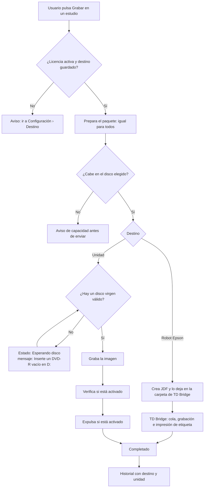

# Análisis · Destino de grabación (robot Epson y unidades CD/DVD)

> **Parcialmente superado** por `propuesta-flujo-destinos.md` (el destino se elige al grabar, grabación en paralelo, etiqueta en papel). Este documento queda como análisis del código actual.

Estado: **análisis, sin diseño ni código.** Parte de lo que hace hoy AP1 (código revisado en `apps/ap1-publisher`) y propone cómo separar el *destino* de la grabación sin romper configuraciones.

## 1. Cómo funciona hoy

| Tema | Hoy | Dónde |
|------|-----|-------|
| Grabación | Todo pasa por **TD Bridge**: se genera un archivo `.jdf` y se deja en la carpeta de monitoreo; TD Bridge y el robot Epson hacen el resto | `adapters/tdbridge_publisher.go` |
| Abstracción | Existe una interfaz (`EpsonPublisher`: crear y enviar trabajo) pero tiene nombre y supuestos de Epson | `adapters/epson_publisher.go` |
| Estado del trabajo | Se deduce por la extensión del archivo que TD Bridge renombra (`.JDF`, `.INP`, `.DON`, `.ERR`…) | `adapters/epson_job_monitor.go` |
| Estados | `QueuedForEpson`, `Processing`, `Publishing`, `Completed`, `Failed` (nombres ligados a Epson) | `shared/models` |
| Configuración | Una sola sección `epson` con **todo mezclado**: tipo de disco, formato, modo y superficie de impresión, carpeta de TD Bridge, copias, `enabled` | `internal/config/config.go` |
| Interfaz | «Grabado» (disco, formato, impresión) y «Etiqueta» (hospital, logo). «Epson» aparece en el pie de Estudios y «Estado TD Bridge» en el detalle de errores del Historial | `SettingsView.tsx`, `StudiesView.tsx`, `HistoryView.tsx` |
| Carpeta de TD Bridge | No se edita en la interfaz; en Windows se fuerza a `C:\EPSON\TDBridge\Orders` | `config.go` |
| Copias | Existe `defaultCopies` pero no hay campo en la interfaz | `config.go` |

## 2. Idea central: dos ejes independientes

- **Modo** responde *de dónde salen los estudios* (Servidor V1, V2, DICOM SCP).
- **Destino** responde *a dónde se graban* (Robot Epson, Unidad CD/DVD).

Cualquier combinación de modo y destino debe funcionar. El paquete del estudio (datos, visor, `study.dat`, `autorun.inf`) es **el mismo** para ambos destinos; solo cambia quién lo graba.

## 3. Flujo propuesto

Diferencias reales entre los dos destinos:

| Aspecto | Robot Epson (TD Bridge) | Unidad CD/DVD |
|---------|-------------------------|---------------|
| Disco | Lo carga el robot desde su bandeja | **Lo inserta una persona**; hay que esperarlo |
| Cola | TD Bridge gestiona muchos trabajos | Una unidad graba **un disco a la vez** |
| Etiqueta impresa | Sí (superficie y velocidad de impresión) | **No existe**: no hay impresión |
| Tipo de disco | Se declara en el trabajo | Se **detecta** del disco insertado |
| Estados | Los da TD Bridge por archivos | Los da el propio sistema (esperando, grabando, verificando) |
| Errores | Códigos Epson / TD Bridge | Errores del sistema operativo o de la unidad |
| Copias | Un campo en el trabajo | Cada copia exige insertar otro disco |
| Capacidad | Hoy no se valida (no hay chequeo de tamaño) | Se valida contra el disco insertado |

## 4. Estados de trabajo (neutros)

Hoy los nombres mencionan a Epson. Propuesta de estados comunes, con los propios de cada destino:

| Estado | Robot | Unidad |
|--------|-------|--------|
| Preparando | ✔ | ✔ |
| En cola | ✔ (`.JDF`) | ✔ (si hay otro trabajo grabando) |
| **Esperando disco** | — | ✔ |
| Grabando | ✔ (`.INP`/`.RJD`/`.STP`) | ✔ |
| **Verificando** | — | ✔ (opcional) |
| Completado | ✔ (`.DON`) | ✔ |
| Error | ✔ (`.ERR`) | ✔ |

Cada trabajo debe **guardar su destino** (y la unidad usada). Así, aunque el usuario cambie de destino, los trabajos en curso se siguen leyendo con el monitor que corresponde.

## 5. Configuración sin conflictos ni sobrescrituras

Hoy `SaveEpsonConfig` copia cuatro campos de la interfaz a la sección `epson` y reemplaza el publicador activo. Con dos destinos eso se rompe. Reglas propuestas:

1. **Un espacio por opción, nunca compartido.** Estructura: `mode.active` + `mode.v1`, `mode.v2`, `mode.scp` y `destination.active` + `destination.epson`, `destination.drive`. Cambiar de pestaña no borra lo escrito en la otra (por ejemplo, Servidor V1 y V2 no comparten host ni puerto).
2. **Lo común va aparte.** Tipo de disco, formato y copias son decisiones de grabación que aplican a ambos y no deben vivir dentro de `epson`. La impresión de etiqueta sí es solo del robot.
3. **Migración sin pérdida.** La configuración actual se convierte en `destination.active = epson` y `destination.epson = {sección actual}`. Nada se pierde ni cambia de comportamiento al actualizar.
4. **Cada sección guarda solo sus campos.** Guardar «Destino» no reescribe «Modo», «Etiqueta» ni la licencia.
5. **Guardar no se habilita hasta cargar.** Hoy la sección «Grabado» arranca con valores por defecto (DVD, UDF 1.02) y se carga después; si alguien guarda antes de que termine la carga, **sobrescribe** lo guardado con los valores por defecto. Hay que bloquear Guardar hasta que los datos reales estén cargados.
6. **Un solo publicador por destino.** El sistema debe tener un monitor y un publicador por cada destino, y elegir según el destino **del trabajo**, no según el destino actual.
7. **Guardar valida primero.** Si los datos del destino no son válidos, no se guarda y el modo/destino anterior se mantiene.
8. **Aviso al salir con cambios sin guardar** (en Modo y en Destino).

## 6. Cambios propuestos en la interfaz

**Configuración** (menú lateral): `Modo`, **`Destino`** (nuevo, debajo de Modo), `Grabado`, `Etiqueta`, `Acerca de`.

- **Destino**: selector segmentado arriba, como en Modo: `Robot Epson` · `Unidad CD/DVD`. La pestaña seleccionada es el destino activo, y se aplica con el mismo pie «Guardar».
  - *Robot Epson*: estado de TD Bridge (carpeta accesible o no), carpeta de monitoreo, copias, superficie y velocidad de impresión.
  - *Unidad CD/DVD*: lista de unidades detectadas (nombre, letra, tipos de disco que acepta), botón Actualizar, unidad elegida, velocidad, casillas «Verificar al terminar» y «Expulsar al terminar».
- **Grabado** pasa a ser lo común: tipo de disco y formato. Hoy mezcla disco con impresión; la impresión se mueve a Destino › Robot.
- **Etiqueta** (hospital y logo): solo aplica al robot. Si el destino es una unidad, la sección muestra «Se imprime solo en el robot Epson» y queda deshabilitada, en lugar de desaparecer.

**Estudios**
- El pie cambia «Epson» por un chip de destino: `Destino: Robot Epson` o `Destino: Unidad D:`, con su punto de estado.
- Estados de los botones de grabar con palabras neutras: «En cola», «Esperando disco», «Grabando…».
- Si el destino es una unidad y no hay disco: aviso claro con la unidad y el tipo de disco esperado, y botón «Reintentar».
- Antes de enviar: aviso si el estudio no cabe en el disco elegido.
- Sin destino guardado: el mismo estado «Sin configurar» que ya existe para el modo.

**Historial**: nueva columna o etiqueta con el destino (y la unidad); el detalle de error deja de decir «Estado TD Bridge» y muestra los campos del destino que corresponda.

**Barra lateral**: sin cambios; la insignia de trabajos activos sigue igual.

## 7. Incongruencias y puntos que hay que decidir

Ver la lista de preguntas en la conversación. Resumen de dónde chocan las ideas:

- La etiqueta, la impresión y el tipo de disco asumen un robot: con una unidad no existen o se detectan.
- Las copias y la cola funcionan distinto: el robot encola; la unidad necesita a una persona por disco.
- «Guardar» tiene hoy tres comportamientos (Modo global, y Grabado y Etiqueta cada uno con el suyo).
- `epson.enabled` existe como bandera pero no tiene pantalla; con un destino activo pierde sentido.
- No hay validación de capacidad en ningún destino hoy.
- Blu-ray: el formato UDF 2.50 está marcado como «pendiente de confirmar con TD Bridge».

## 8. Orden de trabajo sugerido

1. **Diseño en Penpot** (esta etapa): Destino › Robot, Destino › Unidad (con y sin unidades), Grabado reducido, Etiqueta deshabilitada, pie de Estudios, estados nuevos y Historial.
2. Documentar reglas y criterios de aceptación en el registro de cambios.
3. Separar la configuración (migración) y los publicadores por destino.
4. Implementar el destino «Unidad» con su monitor y pruebas.
5. Adaptar la interfaz y renombrar los textos de Epson.
