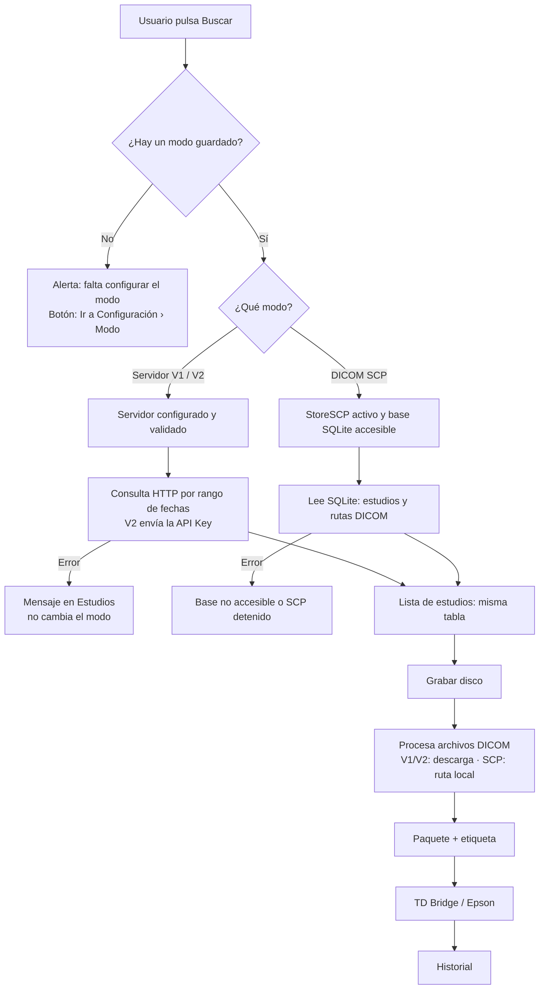
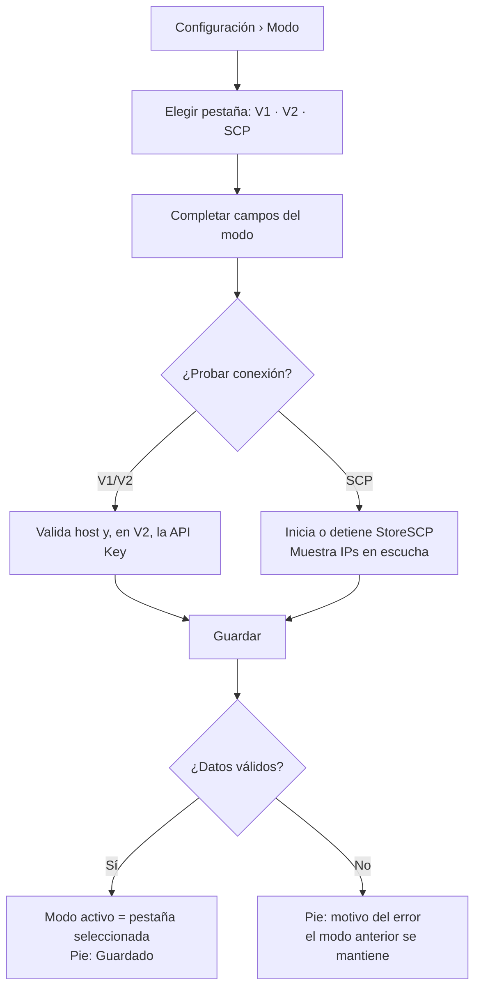

# Flujo de trabajo por modos — AP1 v2.1

Describe cómo cambia el flujo de la aplicación al introducir el **modo de trabajo**. Solo diseño: no está implementado. Las pantallas están en Penpot (página `AP1 v2.1 · Modos de trabajo`) y el diagrama en `AP1 v2.1 · Registro y flujo`.

## Modos

| Modo | Fuente de estudios | Configuración |
|------|--------------------|---------------|
| Servidor V1 | Servidor Symphony V1 (HTTP) | Servidor/IP, puerto, protocolo, tiempo de espera |
| Servidor V2 | Servidor Symphony V2 (HTTP) | Igual que V1 + **API Key** |
| DICOM SCP | Base SQLite interna del sistema con rutas de archivos DICOM | AE Title, puerto, StoreSCP (activo/apagado con Iniciar/Detener), inicio automático. La ruta de la base no se configura |

Solo hay **un modo activo** a la vez: el de la pestaña seleccionada, que se aplica al pulsar Guardar.

## Flujo al pulsar Buscar

**Idea clave:** a partir de «Lista de estudios» el flujo es el mismo en los tres modos. La diferencia está solo en de dónde salen los estudios y los archivos.

## Flujo de configuración

## Estados de pantalla

| Pantalla | Estado | Qué se ve |
|----------|--------|-----------|
| Modo | Sin cambios | Pie «Guardado» (verde) y «Modo de trabajo: …» |
| Modo | Con cambios | Pie «Cambios sin guardar» (ámbar) |
| Modo › SCP | StoreSCP activo | Indicador verde «Servidor activo», botón rojo **Detener** (stop) y lista de IP : puerto |
| Modo › SCP | StoreSCP apagado | Indicador gris «Servidor apagado», botón azul **Iniciar** (play) y lista vacía |
| Estudios | Sin modo guardado | Alerta + «Ir a Configuración» |
| Estudios | Con resultados | Chip «Modo: …» en el pie; en SCP también estado de SCP y base |

## Reglas
1. El modo activo es el de la pestaña seleccionada, y se aplica al pulsar Guardar.
2. Buscar usa el modo aplicado con el último Guardar.
3. En V1 y V2, Buscar exige un servidor configurado y validado. En SCP exige base SQLite accesible; el estado de StoreSCP se muestra pero no bloquea la lectura de lo ya indexado (**a confirmar**).
4. La licencia sigue controlando Buscar y Grabar igual que hoy.
5. Los colores y componentes nuevos usan los tokens existentes (`Oscuro/…`, `Claro/…` en la librería de Penpot).

## Preguntas abiertas
1. **Esquema de la base SQLite** (interna): tablas y columnas de paciente, estudio, fecha, modalidad y ruta, para poder leerla desde Buscar.
2. **Rutas:** ¿son locales o de red? Si son de red, ¿qué pasa si no están disponibles?
3. **Rango de fechas** en SCP: ¿filtra por fecha del estudio o por fecha de recepción?
4. **Cambio de modo con trabajos activos:** ¿se bloquea Guardar mientras haya trabajos de grabado en curso?
5. **StoreSCP al cerrar la aplicación:** ¿se detiene o sigue como servicio?
