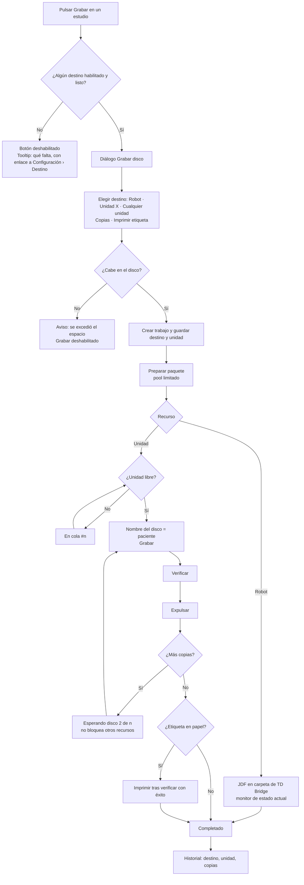

# Propuesta · Flujo e interfaz de Destinos de grabación

Estado: **propuesta para aprobar, sin dibujos ni código.** Incorpora las respuestas del usuario al análisis previo (`analisis-destino-grabacion.md`) y cambia varias de sus conclusiones.

## 1. Decisiones tomadas (respuestas del usuario)

| # | Decisión | Consecuencia de diseño |
|---|----------|------------------------|
| 1 | El destino **se elige al grabar**, no es uno solo activo | «Destino» deja de ser un selector tipo Modo: pasa a ser una lista de destinos **habilitados**, y el estudio se envía a uno de ellos |
| 2 | Grabaciones **en paralelo**, sin importar la tecnología | Hace falta un planificador con una cola por recurso (ver §4) |
| 3 | Robot solo Windows; unidad directa en Windows y Mac | El robot se oculta en Mac; la grabación directa necesita una capa por sistema operativo |
| 4 | La unidad se llama como el paciente; opción de **imprimir etiqueta en impresora de papel** (papel adhesivo) | La sección Etiqueta **no se deshabilita** con unidad: pasa a ser común y gana configuración de impresora de papel |
| 5 | Robot: tipo y formato configurados. Unidad: se detectan del disco insertado | «Grabado» (tipo/formato) pasa a pertenecer solo al robot |
| 6 | Si no cabe, **se bloquea y se avisa** | Validación de capacidad en ambos destinos |
| 7 | Verificar (activado por defecto) y expulsar son opciones | En la tarjeta de Unidades |
| 8 | Copias, por defecto 1 | Campo en el diálogo de grabar, con valor por defecto en Destino |
| 9 | No se puede pulsar Grabar hasta que **al menos un destino esté listo** | El botón depende del estado de los destinos |
| 10 | Todos los destinos, incluido Epson, tienen bandera de habilitado | Interruptor «Habilitado» por destino |
| 11 | Cada trabajo conserva el destino con que se envió | Se guarda destino y unidad en el trabajo |
| 12 | Solo se guarda si el destino está operativo; debe haber al menos un destino activo | Guardar valida (ver §6) |

## 2. Qué cambia respecto al análisis anterior

- El destino ya **no es un eje de configuración único** (como Modo), sino una **lista de recursos** entre los que se elige al grabar.
- La pestaña lateral **Grabado desaparece**: sus campos se van a Destino › Robot Epson. Etiqueta queda como sección común.
- El pie de Estudios deja de mostrar un solo chip de destino y muestra **el estado de cada recurso**.
- Aparece un **diálogo «Grabar disco»** al pulsar grabar (hoy se envía directo).

## 3. Conceptos

- **Recurso**: algo que puede grabar un disco. Hay dos clases: el **Robot Epson** (uno) y las **Unidades** (cero o más, cada una es un recurso).
- **Habilitado** (lo decide el usuario) y **Estado** (lo mide el sistema) son cosas distintas:

| Estado del recurso | Robot Epson | Unidad |
|--------------------|-------------|--------|
| No disponible | Carpeta de TD Bridge inaccesible o es macOS | Unidad desconectada |
| Sin disco | — | Hay unidad, no hay disco virgen válido |
| Listo | Carpeta accesible | Disco virgen detectado, con capacidad conocida |
| Ocupado | Trabajos en TD Bridge (informativo; sigue aceptando) | Grabando o verificando |

- **Se puede grabar** cuando existe al menos un recurso *Habilitado* y *Listo* (o, para el robot, *Ocupado* que aún acepta trabajos).

## 4. Paralelismo y colas

Reglas para evitar choques:

1. **Una cola por recurso.** La unidad graba un disco a la vez. El robot lo gestiona TD Bridge (el monitor de archivos actual sigue igual).
2. **Un candado por unidad.** Un dispositivo nunca recibe dos trabajos a la vez, aunque dos trabajos lo hayan elegido.
3. **Preparación separada de grabación.** Descargar y armar el paquete no usa la unidad; se hace mientras otro disco se graba. Esa preparación se limita (por defecto 2 a la vez) para no saturar disco ni red.
4. **Carpeta de trabajo por trabajo.** Cada trabajo usa su propia carpeta temporal (ya es así hoy) y se limpia al terminar.
5. **Opción «Cualquier unidad disponible».** Asigna al primer recurso listo y reparte lotes en paralelo. Si se elige una unidad ocupada, el trabajo queda «En cola #n en D:».
6. **Unidad que se desconecta:** en cola → el trabajo pasa a «Pausado: unidad no disponible» y se puede reasignar; grabando → Error (el disco queda inservible).
7. **La aplicación se cierra a mitad de grabación:** los trabajos del robot se recuperan por sus archivos; los de unidad se marcan «Interrumpido».
8. **Tope de grabaciones simultáneas** (por defecto = unidades listas, máximo recomendado 3 por ancho de banda USB).
9. **Los trabajos esperando disco no bloquean** a los demás recursos.

## 5. Estados de trabajo (neutros)

Preparando → En cola → **Esperando disco** (solo copias 2+) → Grabando → **Verificando** → **Imprimiendo etiqueta** → Completado · Error · Cancelado · Interrumpido.

El robot usa los suyos, traducidos desde las extensiones de TD Bridge (`.JDF` = En cola, `.INP/.RJD/.STP` = Grabando, `.DON` = Completado, `.ERR` = Error).

## 6. Configuración sin conflictos

Estructura (una rama por destino, ninguna comparte campos):

- `destination.epson`: habilitado, tipo de disco, formato, superficie y velocidad de impresión, copias por defecto. (La carpeta de TD Bridge sigue siendo interna.)
- `destination.drive`: habilitado, unidades permitidas (por identificador estable, no por letra), verificar, expulsar, copias por defecto.
- `label`: hospital, logo y **impresora de papel** (nombre, tamaño/plantilla, imprimir automáticamente sí/no). Común a ambos.
- `burn.maxParallel`, `burn.maxPreparing`.

Reglas:
1. **Migración:** la sección `epson` actual pasa a `destination.epson` con `habilitado = true`. `epson.enabled` se sustituye por este habilitado.
2. **Cada tarjeta guarda solo lo suyo.** Guardar no reescribe Modo, Etiqueta ni la licencia.
3. **Guardar no se activa hasta cargar** los datos reales (corrige el riesgo de pisar con valores por defecto).
4. **Validación al guardar:** se comprueba cada destino *habilitado*: robot → carpeta accesible; unidad → al menos una unidad detectada y seleccionada (no exige disco insertado). Debe quedar **al menos un destino habilitado y operativo**. Si no, no se guarda y se indica por qué.
5. Un destino que **después** se vuelve no disponible no se borra ni se deshabilita: solo aparece «No disponible» en el diálogo de grabar.
6. **Aviso al salir con cambios sin guardar.**

## 7. Interfaz propuesta

### 7.1 Configuración

Menú lateral: `Modo` · **`Destino`** · `Etiqueta` · `Acerca de` (Grabado se fusiona en Destino).

**Destino** son **tarjetas apiladas, no pestañas**, para no repetir la regla de Modo («pestaña seleccionada = activa»), que aquí sería falsa porque pueden estar activos varios:

- **Tarjeta Robot Epson**: interruptor Habilitado; chip de estado («Listo» / «No disponible: carpeta de TD Bridge inaccesible»); tipo de disco (CD · DVD · Blu-ray) y formato; superficie y velocidad de impresión; copias por defecto. En Mac: tarjeta atenuada «Disponible solo en Windows».
- **Tarjeta Unidades CD/DVD**: interruptor Habilitado; lista de unidades detectadas (nombre, letra o punto de montaje, tipos de disco que acepta, estado Sin disco / Listo / Ocupado) cada una con casilla «Usar» y botón Actualizar; casillas «Verificar al terminar» (activa) y «Expulsar al terminar»; copias por defecto; texto «El tipo y formato se detectan del disco insertado».
- **Tarjeta Grabaciones simultáneas** (avanzado, plegada): máximo de grabaciones y de preparaciones a la vez.
- Pie fijo igual que Modo: «Guardado» / «Cambios sin guardar» + **Guardar**; muestra el motivo si falla la validación.

**Etiqueta** (común): hospital y logo, como hoy; nuevo bloque **«Etiqueta en papel»**: impresora, tamaño de etiqueta, vista previa, «Imprimir automáticamente al completar». El robot sigue imprimiendo sobre el disco; el papel aplica solo a unidades.

### 7.2 Estudios

- **Botón Grabar** por estudio: habilitado solo si hay un destino listo; si no, tooltip con la causa y atajo a Destino.
- **Diálogo «Grabar disco»** (nuevo, ligero):
  - Lista de destinos con su estado y disco: `Robot Epson · Listo`, `Unidad D: Pioneer · DVD-R virgen 4,7 GB · Listo`, `Unidad E: · Sin disco`, `Cualquier unidad disponible`. Recuerda la última elección.
  - **Barra de capacidad**: tamaño del estudio frente al disco; roja y con «Se excedió el espacio» si no cabe, y Grabar deshabilitado.
  - Copias (por defecto 1) y, si el destino es unidad, interruptor «Imprimir etiqueta en papel».
  - Botón **Grabar**.
- **Pie**: en lugar de «Epson», una fila de chips por recurso habilitado con punto de estado: `● Robot Epson · Listo`, `● D: · DVD virgen`, `● E: · Grabando 43 %`.
- Botón del estudio con estados neutros: «En cola», «Esperando disco», «Grabando…», «Verificando».

### 7.3 Historial

- Columna **Destino** (Robot / D: …) y **Copias** (1 de 2).
- Filtro por destino además de «Con error».
- Detalle de error: «Estado TD Bridge» solo si fue por robot; para unidad, error del sistema.
- Sección superior «En curso» con una fila por recurso (carril): qué graba y progreso.

### 7.4 Barra lateral

Sin cambios; la insignia cuenta los trabajos activos de todos los recursos.

## 8. Capa técnica (para la implementación)

- Interfaz común de destino: `Publisher` con `Resource`, `Submit`, `Status`, `Cancel`. El adaptador actual de TD Bridge pasa a ser el publicador `epson`.
- `DiscBurner` por sistema operativo: Windows con IMAPI2 (construye UDF y graba nativamente); macOS con `hdiutil` y `drutil` (DiscRecording). Etiquetas de volumen limitadas (32 caracteres, sin acentos, en mayúsculas).
- Mapa de formato por medio detectado: CD → ISO 9660 + Joliet; DVD → UDF 1.02; Blu-ray → UDF 2.50.
- Impresión de etiqueta: plantilla renderizada a PDF e impresa con la impresora del sistema.
- Cada trabajo guarda `destino`, `unidad`, `copiaActual/copiasTotal`.

## 9. Puntos abiertos

Resueltos con los valores recomendados:

1. **Copias en unidad:** la copia 2 y siguientes quedan en «Esperando disco 2 de n» sin bloquear otros recursos.
2. **Etiqueta en papel:** se imprime automáticamente solo tras verificar con éxito; configurable (automática o manual). Formato de papel elegible en Etiqueta (hoja A4, rollo o circular).
3. **Guardar:** se validan solo los destinos habilitados que se están editando; si uno no está disponible se ofrece «Guardar y deshabilitar los no disponibles».
4. **Unidad operativa:** basta con que esté conectada. El disco solo se exige para grabar.
5. **Discos regrabables o usados:** se rechazan («Inserte un disco virgen»).
6. **Verificar:** relectura completa por defecto.
7. **Blu-ray en unidades:** incluido (UDF 2.50, lo controla AP1).
8. **Nombre del disco:** `APELLIDO NOMBRE`, mayúsculas, sin acentos, máximo 32 caracteres.

Supuesto adicional: el robot valida la capacidad con el tipo de disco configurado, porque no detecta el disco.

Pendiente menor: selección múltiple de estudios para grabar en lote (se diseña primero la grabación individual).

## 10. Orden de trabajo

1. Aprobar esta propuesta y responder los puntos abiertos.
2. Diseño en Penpot: Destino (tarjetas, estados), Etiqueta con papel, diálogo Grabar disco (listo / sin disco / no cabe / sin destino), pie de Estudios, Historial.
3. Registrar fichas C-009 en adelante.
4. Separar configuración y publicadores; migración.
5. Implementar unidad (Windows y Mac), planificador y etiqueta en papel.
